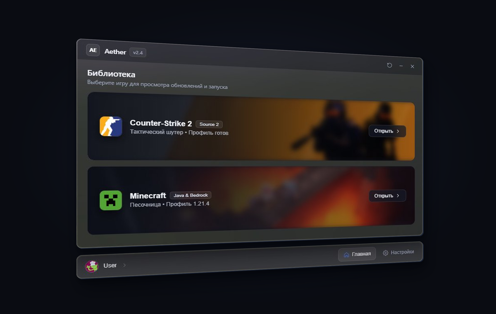

# Noname Loader

<p align="center">
  
</p>

A minimal, dark-acrylic desktop game loader template built with **Rust + Tauri v2** and native Windows **WinHTTP** API integration. Designed to be easily rebranded and extended for custom game clients, launchers, and C++/Java/Rust modules.

## Features
- **Translucent Acrylic Splash**: Compact `360×220` frosted glass startup pill (`Connecting to the server`), smoothly transitioning into the main interface while remembering its exact screen position.
- **Game Library**: Pre-configured in `ui/config.js` with **Counter-Strike 2** and **Minecraft**, wide blurred cards, left dark vignettes, and official icons.
- **Game Details Modal**: Top game banner, mini-icon, close button, stretched dark scrollable changelog container, and animated **START** sequence.
- **Floating Bottom Dock & Profile**: Separate synchronized acrylic bar with a clickable circular user avatar + name on the left (upload custom avatar photo, edit display name, verify license key, copy HWID) and `Home` / `Settings` navigation on the right.
- **Developer File-Based API (`ui/config.js` + `ui/loader_api.js` + `src/api.rs`)**: Ready-to-wire license key verification, HWID binding, CORS-free HTTPS requests, remote payload downloading, and custom launch hooks.

## Rebranding & Customization

1. **App Icon**: Replace `icons/icon.ico` and `icons/icon.png` with your own icon.
2. **Brand Name & Games**: Edit `window.AETHER_CONFIG` in `ui/config.js` (`brandTitle`, `brandShort`, `version`, `games`).
3. **API & Key Verification**:

```js
// ui/config.js
api: {
  statusUrl: "https://api.yoursite.com/v1/status",
  verifyKeyUrl: "https://api.yoursite.com/v1/verify-key",
  authToken: "",
  requireKeyBeforeLaunch: true,
}
```

```js
// ui/loader_api.js (or your own script)
LoaderAPI.onVerifyKey(async ({ key, hwid }) => {
  const res = await LoaderAPI.http("https://api.yoursite.com/v1/verify-key", {
    method: "POST",
    body: { key, hwid },
  });
  const data = JSON.parse(res.body || "{}");
  return {
    valid: Boolean(data.valid),
    plan: data.plan || "Active",
    expires_at: data.expires_at || "30d",
    message: data.message || "Verified",
  };
});

LoaderAPI.onLaunch("minecraft", async (ctx) => {
  ctx.setProgress(35, "Downloading module...");
  await LoaderAPI.download("https://api.yoursite.com/client.jar", "C:\\Games\\client.jar");
  ctx.setProgress(85, "Launching...");
  return false; // return true if your hook launches the process itself
});
```

### Native Rust Commands (`src/api.rs`)
- `api_get_hwid()` — deterministic hardware ID for key binding
- `api_verify_key({ key, hwid, verify_url })` — license key validation hook
- `api_check_server(api_url, auth_token)` — startup status check
- `api_http_request({ url, method, body, auth_token })` — CORS-free WinHTTP GET/POST
- `api_download_module(url, save_path, auth_token)` — download binaries/configs directly to disk
- `api_on_launch({ game_id, target, key, hwid })` — pre-launch native hook

## Build Standalone `.exe`

### Prerequisites
- [Rust & Cargo](https://rustup.rs/)
- Microsoft Visual Studio C++ Build Tools (MSVC)
- Windows WebView2 Runtime (pre-installed on Windows 10/11)

### Build
Run `build.bat` (or `.\build.ps1` in PowerShell). Output binary:
```text
dist/NonameLoader.exe
```

## License
[MIT](LICENSE)
