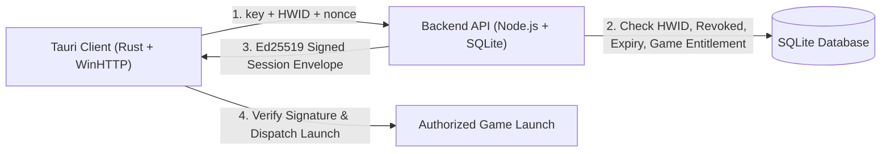

# Noname Loader

<p align="center">
  
</p>

A high-performance Windows Acrylic game loader and launcher template built with **Rust + Tauri v2**, native **WinHTTP**, asymmetric **Ed25519** cryptographic validation, and an integrated **Node.js + SQLite Web Admin Panel**.

Designed for software developers, client modders, and studio teams needing secure hardware-bound licensing, session heartbeat monitoring, anti-debug protections, and modern translucent UI.

---

## Architecture and Cryptography

The application implements a Zero-Client-Secrets security model. No private keys or administrative passwords exist within the client binary. Every launch and session is authenticated and signed by the backend server:



| Security Mechanism | Implementation Details |
|---|---|
| **Zero Client Secrets (Ed25519)** | Private signing keys and `ADMIN_SECRET` reside strictly on the server in `api-server/.env` (generated via `scripts/setup-keys.js`). The client holds only the public key configuration (`sdk/public-config.json`). |
| **Deep Hardware ID (HWID)** | Native Windows queries (`MachineGuid` via Registry, `C:\` Volume Serial via `GetVolumeInformationW`, CPU & Motherboard identifiers) hashed into a deterministic hardware identifier (`NN-XXXX-XXXX-XXXX-XXXX`). |
| **Anti-Debug and Process Integrity** | Native Win32 checks via `IsDebuggerPresent`, `CheckRemoteDebuggerPresent`, and automated detection of blacklisted reverse engineering tools (`x64dbg`, `ida64`, `wireshark`, `fiddler`, `cheatengine`, `httpdebugger`). |
| **Active Session Heartbeat** | The loader polls `/api/v1/auth/heartbeat` every 25 seconds. If a license is revoked, an HWID is reset, or an administrator terminates the session in the web console, the loader immediately revokes local authorization. |
| **Hardened Web Admin Panel** | Challenge-Response HMAC login (`HMAC-SHA256(SHA-512(ADMIN_SECRET), challenge)`), `HttpOnly; SameSite=Strict` session cookies, per-request `x-csrf-token` verification, IP allowlisting (`ADMIN_ALLOWED_IPS`), and automated 15-minute IP lockout after 5 failed login attempts. |

---

## Features

- **Translucent Acrylic Window**: Dual-window interface with frosted glass blur, rounded corners, synchronized dragging, and persistent screen position tracking.
- **Game Library**: Pre-configured for **Counter-Strike 2** and **Minecraft** with blurred backgrounds, dark vignettes, version badges, and full changelog modals.
- **Web Admin Console (`http://127.0.0.1:3840/admin`)**:
  - Issue license keys (`7d`, `30d`, `90d`, `Lifetime`) with selective game entitlements (CS2, Minecraft).
  - Real-time traffic monitor with status code filtering, request rate (RPM), and latency metrics.
  - Active session monitor with one-click session kicking.
  - IP firewall with ban and unban capabilities.
  - Security audit log for tamper alerts, debugger detections, and replay attacks.
- **Offline / Standalone Fallback**: Can operate in standalone mode or seamlessly connect to the backend server.

---

## Quick Start

### 1. Generate Cryptographic Keys & Start Server
```bash
# Generate unique Ed25519 keypair and ADMIN_SECRET
node scripts/setup-keys.js

# Start the SQLite backend & Web Admin Panel (Port 3840)
start-server.bat
```
Open `http://127.0.0.1:3840/admin` in your browser and enter the `ADMIN_SECRET` printed in the console.

> Initial demo license key pre-seeded in database: `NN-DEMO-2026-OPEN` (Lifetime Enterprise access).

### 2. Launch the Loader
```bash
start-loader.bat
```
Or directly run `dist/NonameLoader.exe`.

### 3. Rebuilding the Release Binary
```powershell
powershell -ExecutionPolicy Bypass -File .\build.ps1
```

---

## Project Structure

```
loader/
├── api-server/
│   ├── admin.html          # Web Admin Panel UI
│   ├── admin.js            # Challenge-Response auth & live dashboard logic
│   ├── db.js               # SQLite database engine (node:sqlite)
│   ├── server.js           # HTTP API server & security middleware
│   └── .env                # Server secrets (auto-generated, keep private)
├── scripts/
│   └── setup-keys.js       # Asymmetric keypair generator
├── sdk/
│   └── public-config.json  # Public key and API URL for client distribution
├── src/
│   ├── main.rs             # Multi-window coordinator, Win32 glass & event sync
│   └── api.rs              # Deep HWID engine, WinHTTP client, anti-debug hooks
├── ui/
│   ├── config.js           # Client configuration (branding, API endpoints, games)
│   ├── loader_api.js       # Developer extension layer
│   ├── app.js              # Main window controller, heartbeat & launch sequence
│   ├── dock.js             # Bottom dock controller & view switcher
│   ├── splash.js           # Frosted glass preloader
│   └── styles.css          # Dark slate theme styling
├── dist/
│   └── NonameLoader.exe    # Precompiled standalone Windows binary
├── build.ps1               # Automated release build script
├── start-server.bat        # One-click server launcher
└── start-loader.bat        # One-click client launcher
```

---

## License

This project is licensed under the MIT License. See [LICENSE](LICENSE) for details.
